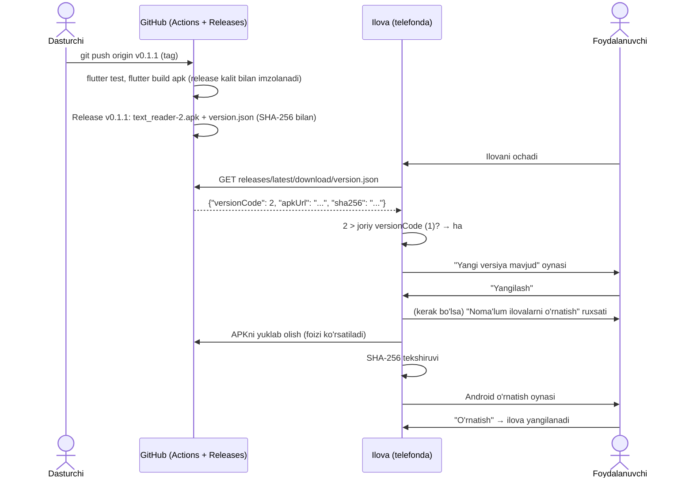
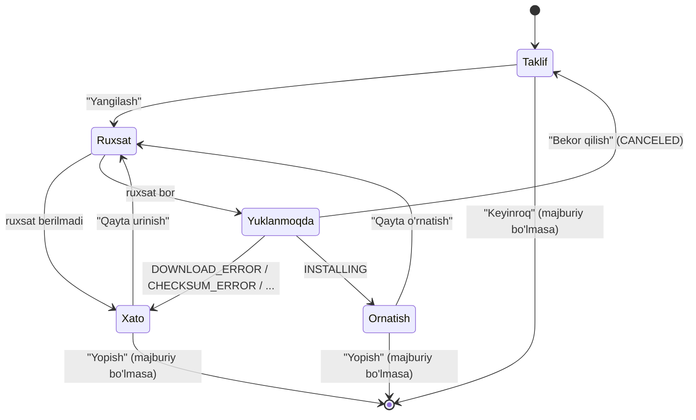

# OTA yangilash (Android) — to'liq qo'llanma

Bu hujjat `text_reader` ilovasiga qo'shilgan **OTA (over-the-air) yangilash** tizimini boshidan oxirigacha
tushuntiradi: u qanday ishlaydi, har bir fayl va kod bo'lagi nima qiladi, yangi versiya qanday chiqariladi
va muammo chiqsa nima qilish kerak.

## Mundarija

1. [Qisqacha: yangi versiya chiqarish](#1-qisqacha-yangi-versiya-chiqarish)
2. [Umumiy tushuncha](#2-umumiy-tushuncha)
3. [Versiyalash qoidalari](#3-versiyalash-qoidalari)
4. [`version.json` formati](#4-versionjson-formati)
5. [Ilova ichida nima bo'ladi (oqim)](#5-ilova-ichida-nima-boladi-oqim)
6. [Fayllar bo'yicha batafsil tushuntirish](#6-fayllar-boyicha-batafsil-tushuntirish)
7. [Imzolash kaliti (keystore) — eng muhim qism](#7-imzolash-kaliti-keystore--eng-muhim-qism)
8. [Bir martalik sozlash (GitHub)](#8-bir-martalik-sozlash-github)
9. [Har safar yangi versiya chiqarish](#9-har-safar-yangi-versiya-chiqarish)
10. [Lokal sinov (GitHub'siz)](#10-lokal-sinov-githubsiz)
11. [Xavfsizlik](#11-xavfsizlik)
12. [Muammolar va yechimlar](#12-muammolar-va-yechimlar)
13. [Kelajakda yaxshilash mumkin bo'lgan narsalar](#13-kelajakda-yaxshilash-mumkin-bolgan-narsalar)

---

## 1. Qisqacha: yangi versiya chiqarish

```bash
# 1. pubspec.yaml dagi versiyani oshiring:  version: 0.1.0+1  →  version: 0.1.1+2
# 2. O'zgarishlarni commit va push qiling
git add -A && git commit -m "0.1.1: karta raqamini o'qish yaxshilandi" && git push

# 3. Tag qo'ying — GitHub qolganini o'zi qiladi
git tag -a v0.1.1 -m "Karta raqamini o'qish yaxshilandi"
git push origin v0.1.1
```

Taxminan 10 daqiqadan keyin GitHub'da `v0.1.1` relizi paydo bo'ladi. Foydalanuvchilar ilovani keyingi safar
ochganda **"Yangi versiya mavjud"** oynasini ko'rishadi, "Yangilash"ni bosishadi va ilova yangilanadi.

---

## 2. Umumiy tushuncha

### 2.1. OTA nima?

Odatda Android ilova Play Market orqali yangilanadi. OTA yangilashda esa **ilovaning o'zi** internetdan
yangi versiya bor-yo'qligini tekshiradi, yangi APK faylni yuklab oladi va Android'ning standart o'rnatish
oynasini ochadi. Foydalanuvchi "O'rnatish"ni bosadi va ilova yangilanadi. Bu **yangilash** bo'lgani uchun
(qayta o'rnatish emas) ilovaning ma'lumotlari va ruxsatlari saqlanib qoladi.

### 2.2. Nima uchun GitHub Releases?

Bizda alohida server yo'q, shuning uchun fayllarni **GitHub Releases** da saqlaymiz:

| Afzallik | Izoh |
|---|---|
| Bepul | Release fayllari uchun trafik (bandwidth) limiti yo'q, har bir fayl 2 GB gacha bo'lishi mumkin. |
| Doimiy havola | `https://github.com/<user>/<repo>/releases/latest/download/version.json` doim **eng oxirgi** relizdagi faylga yo'naltiradi. Shuning uchun ilovadagi manzil hech qachon o'zgarmaydi. |
| HTTPS | GitHub faqat HTTPS orqali ishlaydi, qo'shimcha sozlash kerak emas. |
| Avtomatlashtirish | GitHub Actions public repolar uchun bepul — APKni GitHub serverlari o'zi build qiladi. |

**Cheklov:** repo **public** bo'lishi shart. Private repodagi release fayllarini faqat token bilan yuklab olish
mumkin, tokenni esa ilova ichiga qo'yib bo'lmaydi (APK ichidan uni istalgan kishi topib oladi).

### 2.3. Umumiy sxema



### 2.4. Nega faqat Android?

iOS tashqi manbadan ilova o'rnatishga ruxsat bermaydi (faqat App Store, TestFlight yoki Enterprise dasturi).
Shuning uchun iOS'da yangilash tugmasi ko'rinmaydi va tekshiruv umuman o'tkazilmaydi
(`UpdateService.isSupported` → `false`).

---

## 3. Versiyalash qoidalari

`pubspec.yaml` dagi qator:

```yaml
version: 0.1.1+2
```

| Qism | Nomi | Qayerda ishlatiladi |
|---|---|---|
| `0.1.1` | **versionName** | Foydalanuvchiga ko'rsatiladi ("Versiya 0.1.1"). Android'da `versionName`, Dart'da `PackageInfo.version`. Git tag shundan yasaladi: `v0.1.1`. |
| `2` | **versionCode** | Android'ning ichki raqami. Dart'da `PackageInfo.buildNumber`. **Yangilanish faqat shu raqam bo'yicha aniqlanadi.** |

Qoidalar:

1. **Har bir relizda versionCode'ni oshiring** (`+1` → `+2` → `+3`...). Agar oshirmasangiz, ilova yangilanishni
   ko'rmaydi (`2 > 2` — yolg'on), Android ham o'sha yoki kichikroq versionCode'li APKni ustiga o'rnatmaydi.
2. versionName'ni o'zingiz xohlagancha o'zgartirasiz (odatda [semver](https://semver.org/): `major.minor.patch`).
3. Tag doim `v` + versionName bo'ladi. Workflow buni tekshiradi: `pubspec.yaml` da `0.1.1` turib, `v0.1.2`
   tagini push qilsangiz, build xato bilan to'xtaydi.

| Reliz | pubspec | Tag |
|---|---|---|
| Birinchi | `0.1.0+1` | `v0.1.0` |
| Kichik tuzatish | `0.1.1+2` | `v0.1.1` |
| Yangi funksiya | `0.2.0+3` | `v0.2.0` |

---

## 4. `version.json` formati

Bu fayl har bir relizda bor va ilova aynan shuni o'qiydi. Uni qo'lda yozmaysiz — `tool/make_update.dart`
avtomatik yaratadi.

```json
{
  "versionCode": 2,
  "versionName": "0.1.1",
  "apkUrl": "https://github.com/narzu11ayevnodirbek/text_reader/releases/download/v0.1.1/text_reader-2.apk",
  "sha256": "06c76e256b5c148c4df7906287b74ff7a57af4326365d54519a7d35b8c940084",
  "minVersionCode": 0,
  "releaseNotes": "Karta raqamini o'qish yaxshilandi"
}
```

| Maydon | Turi | Majburiy | Ma'nosi |
|---|---|---|---|
| `versionCode` | int | ha | Yangi versiyaning versionCode'i. Ilovadagidan katta bo'lsa — yangilanish bor. |
| `versionName` | string | ha | Dialogda ko'rsatiladigan versiya. |
| `apkUrl` | string | ha | APK manzili. To'liq URL yoki nisbiy nom (`text_reader-2.apk`) bo'lishi mumkin; nisbiy bo'lsa `version.json` turgan papkaga nisbatan to'liq URL qilinadi. GitHub Actions aniq tag'ga ishora qiluvchi **to'liq** URL yozadi (sababi [6.9](#69-githubworkflowsreleaseyml) da). |
| `sha256` | string | yo'q | APK faylining SHA-256 yig'indisi. Berilsa, yuklangan fayl o'rnatishdan oldin shu bilan solishtiriladi. Bo'sh yoki yo'q bo'lsa tekshirilmaydi. |
| `minVersionCode` | int | yo'q (0) | **Majburiy yangilash.** Ilovaning versionCode'i shundan kichik bo'lsa, dialogni yopib bo'lmaydi. `0` — majburiy emas. |
| `releaseNotes` | string | yo'q ("") | "Nima o'zgardi" matni, dialogda ko'rsatiladi. Ko'p qatorli bo'lishi mumkin. |

---

## 5. Ilova ichida nima bo'ladi (oqim)

### 5.1. Avtomatik tekshiruv (ilova ochilganda)

1. `ScannerScreen` birinchi marta chiziladi.
2. Birinchi kadrdan keyin `useUpdateChecker` jimgina (`silent: true`) tekshiruvni boshlaydi.
3. Yangi versiya **bo'lsa** — dialog ochiladi.
4. Yangi versiya **bo'lmasa** yoki **xato** bo'lsa (internet yo'q va h.k.) — foydalanuvchiga hech narsa
   ko'rsatilmaydi, faqat Debug Console'ga yoziladi:
   `Yangilanishni tekshirib bo'lmadi: ...`. Ilova odatdagidek ishlayveradi.

### 5.2. Qo'lda tekshiruv (AppBar'dagi tugma)

AppBar'ning o'ng tomonidagi ⤓ (`Icons.system_update`) tugmasi. Bosilganda:

- tugma o'rnida kichik aylanuvchi indikator chiqadi;
- yangi versiya bo'lsa — dialog;
- bo'lmasa — SnackBar: **"Sizda eng so'nggi versiya: 0.1.0"**;
- xato bo'lsa — SnackBar: **"Yangilanishni tekshirib bo'lmadi. Internetni tekshiring."**

### 5.3. Dialog bosqichlari



| Bosqich | Ekranda | Tugmalar |
|---|---|---|
| Taklif | Versiya, "nima o'zgardi" matni | Keyinroq · **Yangilash** |
| Yuklanmoqda | Progress chizig'i va foiz ("Yuklanmoqda: 42%") | Bekor qilish |
| O'rnatish | "O'rnatish oynasida "O'rnatish" tugmasini bosing..." | Yopish · **Qayta o'rnatish** |
| Xato | Qizil rangdagi xato matni | Yopish · **Qayta urinish** |

Dialog tashqarisiga bosib yopilmaydi (`barrierDismissible: false`). Yuklash ketayotganda "orqaga" tugmasi
ham ishlamaydi — yuklashni faqat "Bekor qilish" to'xtatadi.

### 5.4. Majburiy yangilash

`version.json` da `minVersionCode` foydalanuvchining versionCode'idan katta bo'lsa:

- sarlavha **"Yangilanish majburiy"** bo'ladi;
- "Keyinroq"/"Yopish" tugmalari ko'rinmaydi;
- "orqaga" tugmasi ham dialogni yopmaydi (`PopScope(canPop: false)`).

Masalan, 0.3.0+5 da ma'lumotlar formati o'zgarib, 3 dan eski versiyalar endi ishlay olmasa,
`minVersionCode: 3` bilan chiqarasiz: versionCode 1 va 2 dagilar majburan yangilanadi, 3 va 4 dagilar esa
oddiy (yopsa bo'ladigan) taklifni ko'radi.

> Eslatma: foydalanuvchi ilovani to'liq yopib qayta ochsa, dialog yana chiqadi. Ya'ni majburiylik
> ilovadan foydalanishni to'sadi, lekin ilovani "o'chirib" qo'ymaydi.

### 5.5. "Noma'lum ilovalarni o'rnatish" ruxsati

Android 8.0 (API 26) dan boshlab har bir ilova boshqa APK'larni o'rnatishi uchun alohida ruxsat oladi.
"Yangilash" bosilganda `Permission.requestInstallPackages.request()` chaqiriladi:

- ruxsat oldin berilgan bo'lsa — darhol yuklash boshlanadi;
- berilmagan bo'lsa — Android sozlamalar oynasi ochiladi ("Shu manbadan ruxsat berish" tugmasi bilan).
  Foydalanuvchi uni yoqib, orqaga qaytsa yuklash boshlanadi;
- yoqmasdan qaytsa — dialog xato bosqichiga o'tadi: *"Yangilash uchun sozlamalarda "Noma'lum ilovalarni
  o'rnatish"ga ruxsat bering."*

Ruxsatni **yuklashdan oldin** so'rashimizning sababi: aks holda 78 MB yuklab bo'lingandan keyingina
o'rnatish rad etilgani ma'lum bo'lardi. Android 7 da bu ruxsat alohida mavjud emas, `permission_handler`
uni "berilgan" deb qaytaradi.

### 5.6. Yangilangandan keyin

Android yangi versiyani o'rnatganda eski jarayonni (process) to'xtatadi. Foydalanuvchi o'rnatish oynasida
"Ochish"ni bosadi yoki ilovani o'zi qayta ochadi. Yuklangan APK ilovaning ichki xotirasida
(`files/ota_update/text_reader-update.apk`) qoladi. Fayl nomi doim bir xil, shuning uchun keyingi yuklashda
plagin eskisini o'chirib, o'rniga yangisini yozadi. Xotirada bittadan ortiq APK to'planmaydi.

---

## 6. Fayllar bo'yicha batafsil tushuntirish

Yangi va o'zgargan fayllar:

```
text_reader/
├── .github/workflows/release.yml          ← YANGI: GitHub Actions — build va reliz
├── android/
│   ├── key.properties                     ← YANGI (gitda yo'q!): kalit parollari
│   └── app/
│       ├── build.gradle.kts               ← o'zgardi: desugaring, release imzosi
│       ├── proguard-rules.pro             ← YANGI: R8 uchun ML Kit qoidalari
│       ├── release-keystore.jks           ← YANGI (gitda yo'q!): imzolash kaliti
│       └── src/
│           ├── main/AndroidManifest.xml   ← o'zgardi: ruxsatlar, FileProvider
│           ├── main/res/xml/filepaths.xml ← YANGI
│           ├── debug/AndroidManifest.xml  ← o'zgardi: lokal sinov uchun HTTP
│           └── debug/res/xml/network_security_config.xml ← YANGI
├── docs/OTA_UPDATE.md                     ← shu hujjat
├── lib/
│   ├── hooks/use_update_checker.dart      ← YANGI
│   ├── models/app_update.dart             ← YANGI
│   ├── screens/scanner_screen.dart        ← o'zgardi: AppBar tugmasi
│   ├── services/update_service.dart       ← YANGI
│   └── widgets/update_dialog.dart         ← YANGI
├── test/app_update_test.dart              ← YANGI
├── tool/make_update.dart                  ← YANGI: APK + version.json tayyorlovchi
└── pubspec.yaml                           ← o'zgardi: yangi paketlar
```

### 6.1. `pubspec.yaml`

| Paket | Nima uchun |
|---|---|
| `http` | `version.json` ni yuklab olish uchun (oddiy GET so'rov). |
| `ota_update` | APKni yuklab olish (progress bilan), SHA-256 tekshiruvi va Android o'rnatish oynasini ochish. Faqat Android. |
| `package_info_plus` | Ilovaning joriy versiyasini (`version`, `buildNumber`) olish. |
| `crypto` (dev) | Faqat `tool/make_update.dart` skripti APK'ning SHA-256 yig'indisini hisoblashi uchun. Ilova ichiga kirmaydi. |
| `permission_handler` | Loyihada oldin ham bor edi (kamera uchun). Endi "Noma'lum ilovalarni o'rnatish" ruxsati uchun ham ishlatiladi. |

### 6.2. [`lib/models/app_update.dart`](../lib/models/app_update.dart)

`version.json` ning Dart'dagi ko'rinishi — oddiy, o'zgarmas (`const`) klass.

- **`AppUpdate.fromJson(json, manifestUri)`**
  - `apkUrl` ni `manifestUri.resolve(...)` orqali to'liq URL qiladi. `resolve` qoidasi brauzerdagi havolalar
    bilan bir xil: `https://site.uz/app/version.json` + `text_reader-2.apk` →
    `https://site.uz/app/text_reader-2.apk`. To'liq URL berilgan bo'lsa, u o'zgarishsiz qoladi.
  - `sha256` ni `trim()` va `toLowerCase()` qiladi: kimdir uni katta harflar yoki bo'shliq bilan yozib
    qo'ysa ham tekshiruv buzilmaydi. Bo'sh qator `null` ga aylanadi (tekshirilmaydi).
  - `minVersionCode` va `releaseNotes` bo'lmasa — `0` va `""`.
- **`isNewerThan(current)`** → `versionCode > current`. Yangilanish bor-yo'qligini aniqlaydigan yagona joy.
- **`isForcedFor(current)`** → `current < minVersionCode`. Majburiylikni aniqlaydi.

### 6.3. [`lib/services/update_service.dart`](../lib/services/update_service.dart)

Tarmoq va platforma bilan ishlaydigan qism. Loyihadagi `TextScannerService` uslubida yozilgan.

- **`manifestUrl`**
  ```dart
  static const String manifestUrl = String.fromEnvironment(
    'UPDATE_MANIFEST_URL',
    defaultValue: 'https://github.com/narzu11ayevnodirbek/text_reader/releases/latest/download/version.json',
  );
  ```
  `String.fromEnvironment` qiymati **build paytida** APK ichiga yoziladi. Odatda standart (GitHub) manzil
  ishlatiladi. Boshqa manzil kerak bo'lsa (masalan, lokal sinov), uni build buyrug'ida berasiz:
  `flutter run --dart-define=UPDATE_MANIFEST_URL=http://localhost:8080/version.json`.

- **`isSupported`** — `true` faqat Android'da. Web va iOS'da tekshiruv ham, tugma ham yo'q.

- **`currentVersion()`** — `PackageInfo.fromPlatform()`: `version` = `0.1.0`, `buildNumber` = `"1"`.

- **`checkForUpdate()`** — qadamma-qadam:
  1. Android bo'lmasa — `null`.
  2. `GET manifestUrl`, sarlavhada `Cache-Control: no-cache`: oraliqdagi proxy yoki CDN eski `version.json`
     ni keshdan berib yubormasligi uchun.
  3. `.timeout(10 soniya)`: internet sekin yoki "osilib" qolgan bo'lsa, tekshiruv cheksiz kutib qolmaydi.
  4. Javob 200 bo'lmasa (masalan, 404 — hali reliz yo'q) — `ClientException` otiladi.
  5. `utf8.decode(response.bodyBytes)`: `response.body` server charset ko'rsatmasa matnni **latin1** deb
     o'qiydi va o'zbekcha belgilar (`o'`, `g'`, `ʻ`) buzilib qolardi. Shuning uchun baytlarni o'zimiz UTF-8
     sifatida o'qiymiz.
  6. `AppUpdate` ga aylantirib, joriy `buildNumber` bilan solishtiradi. Yangisi bo'lsa — `AppUpdate`,
     bo'lmasa — `null`.

  GitHub `releases/latest/download/...` manzili 302 redirect qaytaradi. `http` paketi GET so'rovlarda
  redirect'ga o'zi ergashadi (5 tagacha), qo'shimcha sozlash kerak emas.

- **`downloadAndInstall(update)`** → `Stream<OtaEvent>`
  - **Har safar yangi `OtaUpdate()` obyekti** yaratiladi. Sababi: plagin birinchi `execute()` dagi stream'ni
    obyekt ichida saqlab qo'yadi va keyingi chaqiruvlarda o'sha (allaqachon yopilgan) stream'ni qaytaradi.
    Bitta obyektni qayta ishlatsak, "Qayta urinish" ishlamay qolardi.
  - `destinationFilename: 'text_reader-update.apk'` — doim bir xil nom (sababi [5.6](#56-yangilangandan-keyin) da).
  - `sha256checksum` — berilgan bo'lsa, plagin yuklangan faylning SHA-256 yig'indisini hisoblab
    solishtiradi, mos kelmasa `CHECKSUM_ERROR` beradi va o'rnatishni boshlamaydi.

- **`cancelDownload()`** — joriy yuklashni to'xtatadi. Plagin bunga javoban `CANCELED` yuboradi.

### 6.4. [`lib/hooks/use_update_checker.dart`](../lib/hooks/use_update_checker.dart)

Ekran va servis o'rtasidagi "ko'prik". Loyihadagi `useCameraController` kabi custom hook.

```dart
({bool isChecking, VoidCallback check}) useUpdateChecker()
```

Qaytaradigani — Dart 3 record: `isChecking` (tugmada spinner ko'rsatish uchun) va `check` (tugma bosilganda).

Ichidagi qismlar:

| Hook | Vazifasi |
|---|---|
| `useContext()` | SnackBar va dialog ko'rsatish uchun ekranning `BuildContext` i. |
| `useMemoized(UpdateService.new)` | Servis bir marta yaratiladi va qayta chizishlarda saqlanib qoladi. |
| `useState(false)` → `isChecking` | O'zgarsa ekran qayta chiziladi (spinner chiqadi yoki yo'qoladi). |
| `useRef(false)` → `busy` | Tekshiruv ketayotganini yoki dialog ochiqligini bildiradi. Bu `useState` emas, chunki uning o'zgarishi ekranni qayta chizishni talab qilmaydi — u faqat ikkinchi marta boshlanishdan himoya qiladi. |

**`check({required bool silent})`** mantiqi:

1. `busy` bo'lsa — hech narsa qilmaydi. Masalan, avtomatik tekshiruv dialogi ochiq turganda tugma bosilsa,
   ikkinchi dialog ochilmaydi.
2. `isChecking = true` → versiya va `version.json` olinadi.
3. Ichki `try/finally` da `isChecking = false` qilinadi: spinner dialog ochilishidan **oldin** to'xtaydi,
   dialog ochiq turganda aylanib turmaydi.
4. Har bir `await` dan keyin `context.mounted` tekshiriladi: ekran yopilib ketgan bo'lsa, unga SnackBar yoki
   dialog ko'rsatishga urinmaymiz (aks holda xato bo'lardi).
5. Yangilanish yo'q va `silent == false` → "Sizda eng so'nggi versiya" SnackBar.
6. Yangilanish bor → `UpdateDialog.show(...)` va dialog yopilguncha kutiladi (`busy` shu vaqtgacha `true`).
7. Xato → `debugPrint` (har doim) + SnackBar (faqat `silent == false` bo'lsa).

**Avtomatik tekshiruv:**

```dart
useEffect(() {
  if (!UpdateService.isSupported) return null;
  WidgetsBinding.instance.addPostFrameCallback((_) {
    if (context.mounted) check(silent: true);
  });
  return null;
}, const []);
```

- `const []` — faqat bir marta, ekran birinchi yaratilganda ishlaydi.
- `addPostFrameCallback` — `useEffect` ichidagi kod **build vaqtida** bajariladi. U yerda to'g'ridan-to'g'ri
  `isChecking.value = true` qilsak, Flutter *"setState() called during build"* xatosini beradi, dialog
  ochish ham mumkin bo'lmaydi. Shuning uchun birinchi kadr chizilib bo'lgach boshlaymiz.

### 6.5. [`lib/widgets/update_dialog.dart`](../lib/widgets/update_dialog.dart)

Dialogning to'liq UI va yuklash mantiqi. `HookWidget`.

**Holatlar:**

| Hook | Nima saqlaydi |
|---|---|
| `phase` (`_Phase` enum) | `offer`, `downloading`, `installing`, `failed` — [5.3](#53-dialog-bosqichlari) dagi bosqichlar. |
| `progress` (`double?`) | 0.0–1.0. `null` bo'lsa progress chizig'i "noaniq" (u yoqdan bu yoqqa yuguradi) — server `Content-Length` bermaganda foizni hisoblab bo'lmaydi. |
| `error` (`String?`) | Xato bosqichida ko'rsatiladigan matn. |
| `subscription` (`useRef`) | Yuklash stream'iga obuna. Stream tugaganda `null` bo'ladi. |

**Tozalash (`useEffect` cleanup):** dialog biror sabab bilan yo'qolsa va yuklash hali ketayotgan bo'lsa,
obuna bekor qilinadi va `cancelDownload()` chaqiriladi. Aks holda fonda 78 MB yuklanishda davom etardi.

**`startDownload()`:** ruxsatni so'raydi ([5.5](#55-nomalum-ilovalarni-ornatish-ruxsati)), so'ng holatni
tozalab (`progress = null`, `error = null`) `downloading` ga o'tadi va stream'ga obuna bo'ladi. "Qayta urinish"
va "Qayta o'rnatish" ham shu funksiyani chaqiradi.

**`onEvent` — plagin hodisalari qanday qayta ishlanadi:**

| `OtaStatus` | Qachon keladi | Dialog nima qiladi |
|---|---|---|
| `DOWNLOADING` | Yuklash davomida ko'p marta, `value` = foiz (`"42"`) | Progress yangilanadi |
| `INSTALLING` | Yuklash va tekshiruv tugab, o'rnatish oynasi ochilganda | `installing` bosqichi |
| `INSTALLATION_DONE` | Faqat `usePackageInstaller: true` rejimida (biz ishlatmaymiz) | `installing` bosqichi |
| `CANCELED` | `cancelDownload()` dan keyin | `offer` ga qaytadi |
| `DOWNLOAD_ERROR` | Internet uzildi, server xato qaytardi | "Faylni yuklab bo'lmadi. Internet aloqasini tekshiring." |
| `CHECKSUM_ERROR` | SHA-256 mos kelmadi | "Yuklangan fayl buzilgan (SHA-256 mos kelmadi)..." |
| `PERMISSION_NOT_GRANTED_ERROR` | Plagin ruxsat ololmadi | "Ilovani o'rnatishga ruxsat berilmadi." |
| `ALREADY_RUNNING_ERROR` | Oldingi yuklash hali tugamagan | "Yuklab olish allaqachon boshlangan." |
| `INTERNAL_ERROR`, `INSTALLATION_ERROR` | Boshqa kutilmagan xatolar | "Kutilmagan xatolik: <tafsilot>" |

Barcha xatolar `debugPrint('OTA xatolik: ...')` bilan Debug Console'ga ham yoziladi.

**`PopScope(canPop: !forced && phase != downloading)`** — Android "orqaga" tugmasi majburiy rejimda va
yuklash vaqtida dialogni yopmaydi.

**Nega o'rnatish natijasini bilmaymiz?** Standart rejimda plagin Android'ning `ACTION_INSTALL_PACKAGE`
oynasini ochadi va undan keyin nima bo'lganini (bosdi/bekor qildi) xabar qilmaydi. Shuning uchun `installing`
bosqichida "Qayta o'rnatish" tugmasi bor: foydalanuvchi oynani tasodifan yopib qo'ysa, qayta urinishi mumkin.

### 6.6. [`lib/screens/scanner_screen.dart`](../lib/screens/scanner_screen.dart)

Qo'shilgan qism:

```dart
final updates = useUpdateChecker();
...
AppBar(
  title: const Text('Hujjat Skaneri'),
  actions: [
    if (UpdateService.isSupported)
      IconButton(
        tooltip: 'Yangilanishlarni tekshirish',
        onPressed: updates.isChecking ? null : updates.check,
        icon: updates.isChecking ? /* spinner */ : const Icon(Icons.system_update),
      ),
  ],
)
```

`onPressed: null` — tekshiruv ketayotganda tugma o'chiq (bosib bo'lmaydi).

### 6.7. Android fayllari

#### [`android/app/src/main/AndroidManifest.xml`](../android/app/src/main/AndroidManifest.xml)

```xml
<uses-permission android:name="android.permission.INTERNET"/>
```
Internetga chiqish. Debug build'da bu ruxsat oldin ham bor edi (Flutter hot reload uchun qo'shadi),
lekin asosiy (release) manifestda yo'q edi. Endi aniq yozilgan.

```xml
<uses-permission android:name="android.permission.REQUEST_INSTALL_PACKAGES"/>
```
Boshqa APK'larni o'rnatishni **so'rash** huquqi. Busiz Android 8+ da o'rnatish oynasi umuman ochilmaydi.

```xml
<uses-permission android:name="android.permission.WRITE_EXTERNAL_STORAGE" tools:node="remove"/>
<uses-permission android:name="android.permission.INSTALL_PACKAGES" tools:node="remove"/>
```
`ota_update` plagini o'z manifestida bu ruxsatlarni e'lon qiladi va ular bizning manifestga avtomatik
qo'shiladi (*manifest merge*). `tools:node="remove"` ularni olib tashlaydi, chunki:
- `WRITE_EXTERNAL_STORAGE` — plagin 7.0.1 versiyadan beri APKni ichki xotiraga yozadi, tashqi xotira kerak
  emas. Eski Android'larda o'rnatishda ortiqcha "xotiraga ruxsat" so'ralardi.
- `INSTALL_PACKAGES` — so'roqsiz (jim) o'rnatish huquqi, faqat **tizim ilovalariga** beriladi. Oddiy
  ilovaga baribir berilmaydi, faqat ortiqcha ogohlantirishlar keltirib chiqaradi.

Natijada build'dagi manifestda faqat keraklilari qoladi. Tekshirish:
`build/app/intermediates/merged_manifest/release/.../AndroidManifest.xml`.

```xml
<provider
    android:name="sk.fourq.otaupdate.OtaUpdateFileProvider"
    android:authorities="${applicationId}.ota_update_provider"
    android:exported="false"
    android:grantUriPermissions="true">
    <meta-data
        android:name="android.support.FILE_PROVIDER_PATHS"
        android:resource="@xml/filepaths" />
</provider>
```
**Nima uchun kerak:** Android 7.0 dan boshlab boshqa ilovaga (bizda — tizim o'rnatuvchisiga) `file://`
manzil berish taqiqlangan (`FileUriExposedException`). Uning o'rniga `content://` URI berish kerak, uni esa
**FileProvider** yaratadi.
- `authorities` aynan `${applicationId}.ota_update_provider` bo'lishi shart — plagin standart holatda shu
  nomni qidiradi. `${applicationId}` build paytida `uz.flutterchi.text_reader` ga almashadi.
- `exported="false"` — boshqa ilovalar bu provider'ga o'zi murojaat qila olmaydi.
- `grantUriPermissions="true"` — o'rnatuvchiga faylni o'qish uchun vaqtinchalik ruxsat berish imkoni.

#### [`android/app/src/main/res/xml/filepaths.xml`](../android/app/src/main/res/xml/filepaths.xml)

```xml
<files-path name="internal_apk_storage" path="ota_update/"/>
```
FileProvider qaysi papkadagi fayllarni ulasha olishini belgilaydi. `files-path` = ilovaning ichki
`files/` papkasi (`context.getFilesDir()`), `path="ota_update/"` — plagin APKni aynan shu yerga yozadi.
Boshqa papkalarga provider ruxsat bermaydi.

#### [`android/app/src/debug/AndroidManifest.xml`](../android/app/src/debug/AndroidManifest.xml) va [`debug/res/xml/network_security_config.xml`](../android/app/src/debug/res/xml/network_security_config.xml)

Android 9 dan boshlab shifrlanmagan HTTP so'rovlar standart holatda bloklanadi. Lokal sinovda
([10-bo'lim](#10-lokal-sinov-githubsiz)) kompyuterdagi oddiy HTTP serverdan foydalanamiz, shuning uchun
**faqat debug build** uchun va **faqat `localhost`/`127.0.0.1`** ga HTTP ruxsat berilgan. `src/debug/`
ichidagi fayllar release build'ga umuman kirmaydi — release'da faqat HTTPS ishlaydi.

#### [`android/app/build.gradle.kts`](../android/app/build.gradle.kts)

```kotlin
compileOptions {
    isCoreLibraryDesugaringEnabled = true
    ...
}
dependencies {
    coreLibraryDesugaring("com.android.tools:desugar_jdk_libs:2.1.4")
}
```
**Desugaring** — Java'ning yangi API'larini (masalan, `java.time`) eski Android versiyalarida ham ishlatish
imkonini beradi. `ota_update` 7.x shu bilan build qilingan va Android Gradle Plugin kutubxona talab qilsa
ilovada ham yoqilishini talab qiladi. Busiz build *"requires core library desugaring to be enabled"* xatosi
bilan to'xtaydi.

```kotlin
val keystorePropertiesFile = rootProject.file("key.properties")
...
signingConfigs { create("release") { ... } }
buildTypes {
    release {
        signingConfig = if (keystorePropertiesFile.exists()) release else debug
    }
}
```
Release APK `android/key.properties` dagi kalit bilan imzolanadi ([7-bo'lim](#7-imzolash-kaliti-keystore--eng-muhim-qism)).
Fayl bo'lmasa (masalan, boshqa dasturchining kompyuterida) — debug kalit bilan imzolanadi, build buzilmaydi.
Lekin bunday APK OTA uchun yaroqsiz: u bizning release kalit bilan imzolangan versiya ustiga o'rnatilmaydi.
`tool/make_update.dart` bunday holatda ogohlantiradi, GitHub Actions esa build'ni to'xtatadi.

`storeFile` yo'li `android/app/` papkasiga nisbatan hisoblanadi (`file(...)` app modulida chaqiriladi).

#### [`android/app/proguard-rules.pro`](../android/app/proguard-rules.pro)

OTA'ga bevosita aloqasi yo'q, lekin release build'ni ishlatish uchun kerak bo'ldi. Release build'da
**R8** kodni qisqartiradi va ishlatilmayotgan klasslarni olib tashlaydi. `google_mlkit_text_recognition`
xitoy, devanagari, yapon va koreys yozuvlari uchun klasslarga havola qiladi. Ilova faqat lotin yozuvini
o'qiydi va bu modullar qo'shilmagan, shuning uchun R8 *"Missing class ...KoreanTextRecognizerOptions"*
deb build'ni to'xtatardi. `-dontwarn` qoidalari R8 ga bu klasslar yo'qligini bilishimizni aytadi. Flutter
`android/app/proguard-rules.pro` faylini avtomatik ulaydi.

### 6.8. [`tool/make_update.dart`](../tool/make_update.dart)

APK va `version.json` ni bitta buyruq bilan tayyorlaydi. GitHub Actions ham aynan shuni ishlatadi, lekin
uni lokal ham ishga tushirish mumkin:

```bash
dart run tool/make_update.dart --notes "Nima o'zgardi"
```

| Argument | Ma'nosi |
|---|---|
| `--notes "matn"` | `releaseNotes`. |
| `--notes-file fayl` | `releaseNotes` ni fayldan o'qiydi (ko'p qatorli matn uchun qulay). |
| `--min-version-code N` | Majburiy yangilash chegarasi (standart `0`). |
| `--apk-base-url URL` | `apkUrl` ni shu manzil + fayl nomi qilib yozadi. Berilmasa — nisbiy nom (`text_reader-2.apk`). |
| `--manifest-url URL` | Build'ga `--dart-define=UPDATE_MANIFEST_URL=URL` qo'shadi. Yangi APK ham keyingi yangilanishlarni shu manzildan qidirishi uchun (lokal sinovda kerak). |
| `--debug` | Release o'rniga debug APK (lokal sinov uchun). |

Ishlash tartibi:
1. `pubspec.yaml` dan `version: X+Y` ni o'qiydi.
2. Release rejimida `android/key.properties` yo'q bo'lsa — ogohlantiradi.
3. `flutter build apk --release` (yoki `--debug`) ni ishga tushiradi, chiqishini ekranga uzatadi.
4. `build/ota/` ni tozalab, APKni `build/ota/text_reader-<versionCode>.apk` ga ko'chiradi.
5. SHA-256 ni hisoblaydi (`package:crypto`, faylni oqim bilan o'qiydi — xotiraga butunlay yuklamaydi).
6. `build/ota/version.json` ni yozadi.

### 6.9. [`.github/workflows/release.yml`](../.github/workflows/release.yml)

GitHub Actions — GitHub serverlarida (Ubuntu virtual mashina) avtomatik ishlaydigan skript.

**Qachon ishga tushadi:**
- `v` bilan boshlanadigan tag push qilinganda (`git push origin v0.1.1`). "Nima o'zgardi" matni tag
  xabaridan olinadi (`git tag -a v0.1.1 -m "..."`).
- Qo'lda: GitHub → **Actions** → **Release APK** → **Run workflow**. Bu yerda "nima o'zgardi" matnini va
  `min_version_code` (majburiy yangilash) ni formaga yozasiz. Tag'ni workflow o'zi yaratadi.

`permissions: contents: write` — workflow'ga reliz yaratish huquqi. `concurrency: release` — bir vaqtda
ikkita reliz build qilinmaydi, ikkinchisi birinchisini kutadi.

**Qadamlar:**

1. **`actions/checkout`** (`fetch-depth: 0`) — kodni va barcha tag'larni yuklab oladi.
2. **Versiyani aniqlash:**
   - `pubspec.yaml` dan versionName va versionCode olinadi, tag = `v<versionName>`.
   - Tag push qilingan bo'lsa: tag nomi pubspec bilan mos kelishi tekshiriladi. Tag xabari `notes.txt` ga
     yoziladi. `git fetch --force ... refs/tags/...` qatori shu uchun kerak: `actions/checkout` annotated
     tag'ni oddiy tag'ga aylantirib qo'yishi mumkin, shunda uning xabari yo'qoladi.
   - Qo'lda ishga tushirilgan bo'lsa: shu tag allaqachon bor-yo'qligi tekshiriladi (versiyani oshirish
     esdan chiqqan bo'lsa to'xtaydi). Formadagi matn `notes.txt` ga yoziladi.
   - Oxirgi relizdagi `version.json` dan oldingi versionCode o'qiladi. Yangisi undan katta bo'lmasa —
     xato. Bu "versionCode'ni oshirish esdan chiqdi" holatidan himoya qiladi (aks holda reliz chiqardi,
     lekin hech kim yangilanmasdi).
3. **Imzolash kalitini tiklash:** GitHub secret'laridan keystore (base64 ko'rinishida) va parollar olinib,
   `android/app/release-keystore.jks` va `android/key.properties` yaratiladi. Birorta secret yo'q bo'lsa,
   build to'xtaydi — aks holda APK debug kalit bilan imzolanib, hech kimga o'rnatilmasdi.
4. **`actions/setup-java`** — Java 17 (Android Gradle Plugin uchun). `cache: gradle` — Gradle
   kutubxonalari keyingi build'lar uchun keshlanadi (tezroq ishlaydi).
5. **`subosito/flutter-action`** — Flutter 3.41.6 (lokaldagi bilan bir xil versiya). `cache: true` — SDK
   keshlanadi.
6. **`flutter pub get`** va **`flutter test`** — testlar o'tmasa reliz chiqmaydi.
7. **APK va `version.json`** — `tool/make_update.dart` ishga tushadi. `--apk-base-url` aniq tag manziliga
   (`.../releases/download/v0.1.1/`) ishora qiladi. Agar `latest` ishlatilganda, foydalanuvchi `version.json`
   ni o'qigan payt bilan APKni yuklagan payt orasida yangi reliz chiqsa, `latest` boshqa relizga o'tib
   qolardi va APK topilmasdi. Aniq tag bilan bu muammo bo'lmaydi.
8. **GitHub Release** — `gh` CLI (GitHub runner'larida oldindan o'rnatilgan) bilan:
   - avval **qoralama** (draft) reliz yaratiladi va ikkala fayl yuklanadi;
   - keyin `--draft=false --latest` bilan e'lon qilinadi.

   Sababi: reliz darhol e'lon qilinsa, fayllar yuklanib bo'lguncha bir necha soniya `latest` reliz
   `version.json` siz qoladi va o'sha paytda tekshirgan ilovalar 404 olardi.

**Secret'lar** ([8.3](#83-github-secretlar) da qanday qo'shiladi):

| Secret | Qiymati |
|---|---|
| `ANDROID_KEYSTORE_BASE64` | `release-keystore.jks` faylining base64 ko'rinishi |
| `ANDROID_KEYSTORE_PASSWORD` | `key.properties` dagi `storePassword` |
| `ANDROID_KEY_ALIAS` | `text_reader` |
| `ANDROID_KEY_PASSWORD` | `key.properties` dagi `keyPassword` |

Secret'lar GitHub'da shifrlangan holda saqlanadi, loglarda `***` bo'lib ko'rinadi va repo public bo'lsa ham
boshqalarga ko'rinmaydi.

### 6.10. [`test/app_update_test.dart`](../test/app_update_test.dart)

`AppUpdate` mantiqini tekshiradi: barcha maydonlarni o'qish, nisbiy `apkUrl` → to'liq URL, ixtiyoriy
maydonlarning standart qiymatlari, `isNewerThan` va `isForcedFor` chegaralari. Ishga tushirish:
`flutter test`. GitHub Actions ham har relizdan oldin shu testlarni ishlatadi.

---

## 7. Imzolash kaliti (keystore) — eng muhim qism

### 7.1. Nima uchun muhim?

Android ilovani yangilashda yangi APK'ning **imzosi** o'rnatilgan ilovaning imzosi bilan bir xil
bo'lishini talab qiladi. Bir xil bo'lmasa: *"App not installed"* / *"Ilova o'rnatilmadi: paket mavjud
paket bilan ziddiyatli"*. Ya'ni:

> **Barcha versiyalar bitta kalit bilan imzolanishi shart.**

### 7.2. Kalit qayerda?

| Fayl | Ichida | Gitda |
|---|---|---|
| `android/app/release-keystore.jks` | Kalitning o'zi (PKCS12, RSA 2048, 10 000 kun amal qiladi) | **yo'q** (`android/.gitignore`: `**/*.jks`) |
| `android/key.properties` | Parol, alias (`text_reader`), fayl nomi | **yo'q** (`android/.gitignore`: `key.properties`) |
| GitHub secret'lari | Xuddi shu ma'lumotlar (CI uchun) | shifrlangan |

Sertifikat: `CN=Text Reader, O=narzu11ayevnodirbek`, SHA-256 barmoq izi:
`8E:16:84:1E:29:03:CE:09:3E:8E:23:47:56:11:CD:6A:A7:26:AE:B4:55:92:1A:1A:19:7C:6B:39:8D:8F:E2:0E`.

### 7.3. ⚠️ Zaxira nusxa oling!

Ikkala faylni (`release-keystore.jks` va `key.properties`) **xavfsiz joyga** nusxalang: parol menejeri,
shifrlangan disk yoki shaxsiy bulut. Kalit yo'qolsa:

- yangi versiyalarni eski ilova ustiga o'rnatib bo'lmaydi;
- har bir foydalanuvchi ilovani o'chirib, qaytadan o'rnatishi kerak bo'ladi (ma'lumotlari yo'qoladi).

GitHub secret'laridagi nusxa **zaxira emas**: secret'ni GitHub'dan qayta o'qib bo'lmaydi, faqat yangisini
yozish mumkin.

### 7.4. Yangi kompyuterda ishlash

Loyihani klonlang va ikkala faylni o'sha joylarga qo'ying:
`android/app/release-keystore.jks` va `android/key.properties`. Boshqa sozlash kerak emas.

### 7.5. Kalit qanday yaratilgan (ma'lumot uchun — QAYTA YARATMANG)

```bash
keytool -genkeypair -keystore android/app/release-keystore.jks -storetype PKCS12 \
  -alias text_reader -keyalg RSA -keysize 2048 -validity 10000 \
  -dname "CN=Text Reader, O=narzu11ayevnodirbek"
```

PKCS12 formatida kalit paroli va ombor (store) paroli bir xil bo'ladi, shuning uchun `key.properties` da
ikkalasi bir xil.

### 7.6. Debug va release imzosi

`flutter run` bilan o'rnatilgan ilova **debug** kalit (`~/.android/debug.keystore`) bilan imzolangan. Release
APK esa boshqa kalit bilan imzolangan, shuning uchun ular bir-birining ustiga o'rnatilmaydi. Telefonda
debug versiya turgan bo'lsa, release APK'ni o'rnatishdan oldin uni bir marta o'chiring:

```bash
adb uninstall uz.flutterchi.text_reader
```

---

## 8. Bir martalik sozlash (GitHub)

### 8.1. GitHub CLI'ga kirish

```bash
brew install gh        # o'rnatilgan
gh auth login          # GitHub.com → HTTPS → brauzer orqali kirish
```

### 8.2. Repo yaratish va kodni yuklash

```bash
cd text_reader
gh repo create narzu11ayevnodirbek/text_reader --public --source . --push
```

### 8.3. GitHub secret'lar

```bash
base64 -i android/app/release-keystore.jks | gh secret set ANDROID_KEYSTORE_BASE64
gh secret set ANDROID_KEY_ALIAS --body text_reader
grep storePassword android/key.properties | cut -d= -f2- | gh secret set ANDROID_KEYSTORE_PASSWORD
grep keyPassword  android/key.properties | cut -d= -f2- | gh secret set ANDROID_KEY_PASSWORD
gh secret list         # 4 ta secret ko'rinishi kerak
```

Brauzer orqali: repo → **Settings** → **Secrets and variables** → **Actions** → **New repository secret**.

### 8.4. Birinchi reliz

```bash
git tag -a v0.1.0 -m "Birinchi versiya"
git push origin v0.1.0
gh run watch           # build jarayonini kuzatish
```

Birinchi versiyani foydalanuvchilar **qo'lda** o'rnatadi (OTA undan keyingi versiyalar uchun ishlaydi):
`https://github.com/narzu11ayevnodirbek/text_reader/releases/latest` sahifasidan
`text_reader-1.apk` ni yuklab olib o'rnatishadi.

---

## 9. Har safar yangi versiya chiqarish

### 9.1. Tag orqali (terminal)

```bash
# 1) pubspec.yaml:  version: 0.1.1+2
git add -A
git commit -m "0.1.1: ..."
git push

# 2) Tag (xabari = "Nima o'zgardi", dialogda ko'rinadi)
git tag -a v0.1.1 -m "Karta raqamini o'qish yaxshilandi
JSHSHIR topilmasa xabar chiqadi"
git push origin v0.1.1

# 3) Kuzatish
gh run watch
```

### 9.2. GitHub sahifasi orqali (majburiy yangilash ham shu yerda)

1. `pubspec.yaml` dagi versiyani oshirib, commit + push qiling.
2. GitHub → repo → **Actions** → chapda **Release APK** → **Run workflow**.
3. *Nima o'zgardi* — matn; *Majburiy yangilash* — `0` yoki versionCode (masalan, `3`).
4. **Run workflow**.

### 9.3. Natijani tekshirish

- GitHub → **Releases**: `v0.1.1`, ichida `text_reader-2.apk` va `version.json`.
- Brauzerda: `https://github.com/narzu11ayevnodirbek/text_reader/releases/latest/download/version.json` —
  yangi `versionCode` ko'rinishi kerak.
- Telefonda eski versiyani oching → dialog chiqadi.

### 9.4. Relizni bekor qilish

Xato reliz chiqib ketsa, eng tez yo'l — **tuzatilgan yangi versiyani** (versionCode'ni yana oshirib)
chiqarish. Relizni o'chirsangiz (`gh release delete v0.1.1 --cleanup-tag`), `latest` oldingi relizga
qaytadi. Lekin uni allaqachon o'rnatganlarga bu ta'sir qilmaydi — Android versionCode'ni pasaytirmaydi.

---

## 10. Lokal sinov (GitHub'siz)

Butun oqimni kompyuterning o'zida, telefon USB orqali ulangan holda sinash mumkin:

```bash
# 1) Telefonga "eski" versiyani o'rnating (pubspec: 0.1.0+1), manzil — kompyuterdagi server
flutter run --dart-define=UPDATE_MANIFEST_URL=http://localhost:8080/version.json

# 2) pubspec.yaml ni vaqtincha 0.1.1+2 qiling va "yangi" versiyani tayyorlang
dart run tool/make_update.dart --debug --notes "Lokal sinov" \
  --manifest-url http://localhost:8080/version.json

# 3) Fayllarni HTTP orqali bering va telefondagi localhost:8080 ni kompyuterga ulang
python3 -m http.server 8080 -d build/ota
adb reverse tcp:8080 tcp:8080        # boshqa terminalda

# 4) Ilovada ⤓ tugmasini bosing → dialog → Yangilash → o'rnatish
# 5) pubspec.yaml ni 0.1.0+1 ga qaytaring
```

Bu yerda ikkala versiya ham shu kompyuterning **debug** kaliti bilan imzolangan, shuning uchun bir-birining
ustiga o'rnatiladi. `localhost` ga HTTP faqat debug build'da ruxsat etilgan ([6.7](#67-android-fayllari)).

---

## 11. Xavfsizlik

| Xavf | Himoya |
|---|---|
| Yo'lda faylni almashtirish (MITM) | GitHub faqat HTTPS. Release build'da HTTP umuman ishlamaydi. |
| Yarim yuklangan yoki buzilgan fayl | `sha256` tekshiruvi — mos kelmasa o'rnatilmaydi (`CHECKSUM_ERROR`). |
| Kimdir boshqa APK chiqarib yuborsa | Android imzo tekshiruvi: bizning kalit bilan imzolanmagan APK ilova ustiga **o'rnatilmaydi**. Bu eng kuchli himoya — shuning uchun keystore sir saqlanishi kerak. |
| Kalit sizib chiqishi | `key.properties` va `*.jks` gitda yo'q. CI'da ular GitHub secret'larida. |
| Public repo | Kod ochiq — unga hech qachon parol, token yoki API kalit yozmang. |

> `sha256` va APK bir joyda (GitHub'da) turgani uchun SHA-256 asosan **butunlikni** (fayl buzilmaganini)
> tekshiradi. Haqiqiylikni (fayl bizniki ekanini) Android imzosi kafolatlaydi.

---

## 12. Muammolar va yechimlar

### 12.1. Ilovada

| Belgi | Sabab | Yechim |
|---|---|---|
| Debug Console: `Yangilanishni tekshirib bo'lmadi: ClientException: HTTP 404` | Hali birorta reliz yo'q, reliz qoralama (draft) holatida, repo private yoki manzil noto'g'ri | GitHub → Releases'ni tekshiring; brauzerda `.../releases/latest/download/version.json` ochilishi kerak |
| Debug Console: `TimeoutException` / `SocketException` | Internet yo'q yoki sekin | Normal holat, ilova ishlayveradi |
| Dialog chiqmaydi, xato ham yo'q | `version.json` dagi `versionCode` o'rnatilgandan katta emas | `pubspec.yaml` da `+` dan keyingi raqamni oshirib, qayta reliz qiling |
| "Yangilash uchun sozlamalarda ... ruxsat bering" | "Noma'lum ilovalarni o'rnatish" yoqilmagan | Sozlamalar → Ilovalar → Text Reader → Noma'lum ilovalarni o'rnatish → Ruxsat |
| Samsung: o'rnatish bloklandi | One UI 6+ da **Auto Blocker** yoqilgan | Sozlamalar → Xavfsizlik va maxfiylik → Auto Blocker → o'chirish |
| "Faylni yuklab bo'lmadi" | Internet uzildi yoki APK manzili noto'g'ri | Qayta urinish; `version.json` dagi `apkUrl` brauzerda ochilishini tekshiring |
| "Yuklangan fayl buzilgan (SHA-256...)" | Yuklash buzildi yoki `version.json` qo'lda tahrirlangan | Qayta urinish; `version.json` ni qo'lda o'zgartirmang |
| Foiz ko'rinmaydi, chiziq yuguradi | Server `Content-Length` bermagan | Xato emas, yuklash davom etadi |
| **"App not installed"** / "paket ziddiyatli" | Imzo mos emas (masalan, telefonda debug versiya turibdi) | `adb uninstall uz.flutterchi.text_reader`, so'ng release APK'ni qo'lda o'rnating ([7.6](#76-debug-va-release-imzosi)) |
| Play Protect: "Xavfli ilova" | Play Market'dan tashqari o'rnatilgan ilovalar uchun odatiy ogohlantirish | "Batafsil" → "Baribir o'rnatish" |
| O'rnatish oynasi yopilib qoldi | Foydalanuvchi bekor qildi | Dialogda "Qayta o'rnatish" |

### 12.2. GitHub Actions'da

| Xato | Yechim |
|---|---|
| `Tag (v0.1.2) pubspec.yaml dagi versiyaga (v0.1.1) mos emas` | Tag'ni o'chiring (`git push --delete origin v0.1.2 && git tag -d v0.1.2`), pubspec'ni to'g'rilab, qayta tag qo'ying |
| `versionCode (2) oldingi relizdagidan (2) katta bo'lishi kerak` | `pubspec.yaml` da `+` dan keyingi raqamni oshiring |
| `v0.1.1 allaqachon mavjud` | Versiyani oshiring (Run workflow uchun) |
| `ANDROID_* secret'lar to'liq emas` | [8.3](#83-github-secretlar) ni bajaring |
| `flutter test` yiqildi | Avval lokal `flutter test` ni tuzating |
| `Keystore was tampered with, or password was incorrect` | `ANDROID_KEYSTORE_PASSWORD` / `ANDROID_KEY_PASSWORD` noto'g'ri — qayta yozing |

### 12.3. Lokal build'da

| Xato | Sabab va yechim |
|---|---|
| `No space left on device` (ba'zan chalg'ituvchi *"Starting AGP 9+ ... Flutter Fix"* xabari bilan) | Diskda joy tugagan. Joy oching. |
| `Could not read workspace metadata from ~/.gradle/caches/.../metadata.bin` | Gradle keshi tozalangan, lekin eski Gradle daemon hali o'chirilgan fayllarni ishlatmoqda: `cd android && ./gradlew --stop`, so'ng qayta build. Birinchi build kutubxonalarni qayta yuklagani uchun sekin bo'ladi. |
| `Missing class com.google.mlkit.vision.text.korean...` (R8) | `android/app/proguard-rules.pro` o'chirilgan bo'lsa — qayta qo'shing ([6.7](#67-android-fayllari)) |
| `requires core library desugaring to be enabled` | `build.gradle.kts` dagi desugaring sozlamasi o'chib ketgan |
| `Ogohlantirish: android/key.properties yo'q` | Kalit fayllari bu kompyuterda yo'q ([7.4](#74-yangi-kompyuterda-ishlash)) |

---

## 13. Kelajakda yaxshilash mumkin bo'lgan narsalar

- **APK hajmini kamaytirish.** Hozirgi APK ~78 MB, chunki u barcha protsessor turlari (arm64, armv7, x86_64)
  uchun kodni o'z ichiga oladi. `flutter build apk --split-per-abi` bilan har biri uchun alohida APK
  (~25–30 MB) qilish mumkin. Ilova `OtaUpdate().getAbi()` bilan o'z turini aniqlab, mos APK'ni yuklaydi.
  Buning uchun `version.json` ga ABI bo'yicha manzillar qo'shish kerak bo'ladi.
- **Wi-Fi'da yuklash.** Mobil internetda katta faylni yuklashdan oldin ogohlantirish.
- **Fonda yuklash.** Hozir yuklash dialog ochiq turganda ketadi. Bildirishnoma (notification) bilan fonda
  yuklash qo'shish mumkin.
- **Har bir push'da tekshiruv.** `main` ga har push'da `flutter analyze` va `flutter test` ishlatadigan
  alohida workflow.
